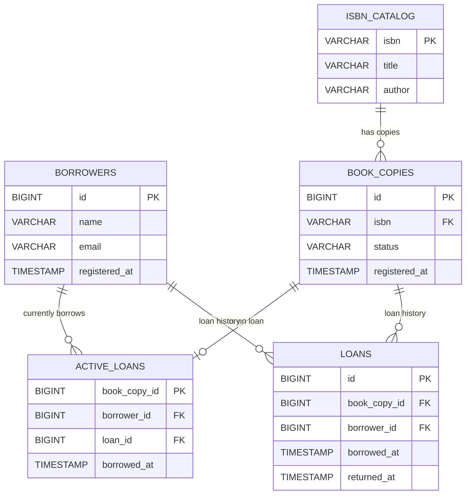

# Library Management REST API

A RESTful backend service for managing library borrowers, book inventory, and loan lifecycle — built with Spring Boot 3, Java 17, and H2 (file-backed in production, in-memory for tests).

---

## Table of Contents

- [Architecture Overview](#architecture-overview)
- [Tech Stack](#tech-stack)
- [Getting Started](#getting-started)
  - [Prerequisites](#prerequisites)
  - [Run Locally](#run-locally)
  - [Run with Docker Compose](#run-with-docker-compose)
- [Configuration](#configuration)
- [Database](#database)
- [API Reference](#api-reference)
  - [Borrowers](#borrowers)
  - [Books](#books)
  - [Borrowing & Returns](#borrowing--returns)
- [Error Responses](#error-responses)
- [Testing](#testing)
- [CI / CD](#ci--cd)
- [Design Decisions & Assumptions](#design-decisions--assumptions)

---

## Architecture Overview

```
┌─────────────┐    HTTP     ┌───────────────┐    JPA     ┌──────────────┐
│   Client    │ ──────────► │  Controllers  │ ─────────► │  Repositories│
│ (curl/UI)   │             │               │            │  (Spring Data)│
└─────────────┘             └───────┬───────┘            └──────┬───────┘
                                    │                           │
                                    ▼                           ▼
                            ┌───────────────┐         ┌────────────────┐
                            │   Services    │         │   H2 Database  │
                            │  (business    │         │  (file-backed) │
                            │   logic)      │         └────────────────┘
                            └───────────────┘
```

### Package Structure

```
com.libraryapp
├── config/          # OpenAPI / Swagger configuration
├── controller/      # REST controllers (Borrower, Book, Borrowing)
├── dto/
│   ├── request/     # Inbound request bodies
│   └── response/    # Outbound response bodies
├── entity/          # JPA entities (Borrower, IsbnCatalog, BookCopy, Loan, ActiveLoan)
├── exception/       # Domain exceptions + global RestExceptionHandler
├── repository/      # Spring Data JPA repositories
├── service/         # Business logic (BorrowerService, BookService, BorrowingService)
└── util/            # ISBN validation & normalisation utility
```

---

## Tech Stack

| Layer | Technology |
|---|---|
| Language | Java 17 |
| Framework | Spring Boot 3.3.5 |
| Persistence | Spring Data JPA + Hibernate |
| Database | H2 (file-backed prod / in-memory test) |
| Migrations | Flyway |
| Validation | Jakarta Bean Validation (Hibernate Validator) |
| API Docs | Springdoc OpenAPI 3 (Swagger UI) |
| Build | Maven (wrapper included) |
| Containerisation | Docker (multi-stage), Docker Compose |
| CI | GitHub Actions |
| Testing | JUnit 5, Mockito, Spring MockMvc |

---

## Getting Started

### Prerequisites

- Java 17+ (verify: `java -version`)
- Maven (or use the included `./mvnw` wrapper)
- Docker & Docker Compose (optional — for containerised run)

### Run Locally

```bash
# Clone the repository
git clone https://github.com/ilhamhmdn/LibraryApp.git
cd LibraryApp

# Build and run (Maven wrapper)
./mvnw spring-boot:run          # Linux / macOS
.\mvnw.cmd spring-boot:run      # Windows PowerShell
```

The application starts on **port 8080** by default.

- Swagger UI → http://localhost:8080/swagger-ui/index.html
- H2 Console  → http://localhost:8080/h2-console
  - JDBC URL: `jdbc:h2:file:./data/librarydb`
  - Username: `sa` / Password: *(leave blank)*

### Run with Docker Compose

```bash
docker compose up --build
```

> The H2 console is **disabled** inside the container. Database files are persisted in a named Docker volume (`library_management_data`).

---

## Configuration

All settings live in `src/main/resources/application.yml`. Key environment variables:

| Variable | Default | Description |
|---|---|---|
| `PORT` | `8080` | HTTP listen port |
| `H2_CONSOLE_ENABLED` | `true` | Enable H2 web console (set `false` in prod/Docker) |

---

## Database

Schema is managed by **Flyway** (`V1__initial_schema.sql`).



---

## API Reference

Base path: `/api/v1`

### Borrowers

#### Register a Borrower

```
POST /api/v1/borrowers
Content-Type: application/json
```

**Request body:**
```json
{
  "name": "Alice Tan",
  "email": "alice@example.com"
}
```

**201 Created — response body:**
```json
{
  "id": 1,
  "name": "Alice Tan",
  "email": "alice@example.com",
  "registeredAt": "2024-01-15T08:30:00Z"
}
```

**Errors:** `400` (validation), `409` (email already registered)

---

#### Get a Borrower

```
GET /api/v1/borrowers/{id}
```

**200 OK — response body:** same shape as register response.

**Errors:** `404` (borrower not found)

---

### Books

#### Register a Book Copy

```
POST /api/v1/books
Content-Type: application/json
```

**Request body:**
```json
{
  "isbn": "978-0-13-110362-7",
  "title": "The C Programming Language",
  "author": "Brian W. Kernighan"
}
```

- ISBN-10 or ISBN-13 accepted (hyphens/spaces stripped; checksum validated).
- Multiple physical copies of the same ISBN can be registered; each call creates a new copy row.
- If the ISBN already exists in the catalog, the supplied `title` and `author` **must** match (case-insensitive) the stored values, otherwise `409` is returned.

**201 Created — response body:**
```json
{
  "id": 1,
  "isbn": "9780131103627",
  "title": "The C Programming Language",
  "author": "Brian W. Kernighan",
  "status": "AVAILABLE",
  "registeredAt": "2024-01-15T08:35:00Z"
}
```

**Errors:** `400` (validation / invalid ISBN), `409` (ISBN metadata mismatch)

---

#### List All Book Copies

```
GET /api/v1/books
```

**200 OK — response body:**
```json
[
  {
    "id": 1,
    "isbn": "9780131103627",
    "title": "The C Programming Language",
    "author": "Brian W. Kernighan",
    "status": "AVAILABLE",
    "registeredAt": "2024-01-15T08:35:00Z"
  }
]
```

---

#### Get a Book Copy

```
GET /api/v1/books/{id}
```

**200 OK — response body:** same shape as a single entry in the list response.

**Errors:** `404` (book copy not found)

---

### Borrowing & Returns

#### Borrow a Book

```
POST /api/v1/borrowers/{borrowerId}/borrowings/{bookId}
```

- Book must be `AVAILABLE`.
- A book copy can only have one active loan at a time (enforced by DB primary key on `active_loans.book_copy_id` + pessimistic lock).

**200 OK — response body:**
```json
{
  "loanId": 1,
  "bookCopyId": 1,
  "borrowerId": 1,
  "isbn": "9780131103627",
  "title": "The C Programming Language",
  "author": "Brian W. Kernighan",
  "borrowedAt": "2024-01-15T09:00:00Z",
  "returnedAt": null
}
```

**Errors:** `404` (borrower/book not found), `409` (book already borrowed)

---

#### Get Borrowing Record

```
GET /api/v1/borrowers/{borrowerId}/borrowings/{bookId}
```

Returns the **active** loan for the given borrower + book copy pair.

**200 OK — response body:** same shape as borrow response.

**Errors:** `404` (no active loan found for this borrower/book pair)

---

#### Return a Book

```
POST /api/v1/borrowers/{borrowerId}/returns/{bookId}
```

- Sets `book_copies.status` back to `AVAILABLE`.
- Moves the loan from `active_loans` to `loans` history (sets `returned_at`).

**200 OK — response body:**
```json
{
  "loanId": 1,
  "bookCopyId": 1,
  "borrowerId": 1,
  "isbn": "9780131103627",
  "title": "The C Programming Language",
  "author": "Brian W. Kernighan",
  "borrowedAt": "2024-01-15T09:00:00Z",
  "returnedAt": "2024-01-20T14:00:00Z"
}
```

**Errors:** `404` (borrower/book not found), `409` (book not currently borrowed / borrower mismatch)

---

## Error Responses

All errors return a consistent JSON envelope:

```json
{
  "timestamp": "2024-01-15T09:00:00Z",
  "status": 409,
  "error": "Conflict",
  "message": "Book copy 1 is already borrowed.",
  "path": "/api/v1/borrowers/1/borrowings/1"
}
```

Validation errors (HTTP 400) include a `fieldErrors` array:

```json
{
  "timestamp": "2024-01-15T09:00:00Z",
  "status": 400,
  "error": "Bad Request",
  "message": "Validation failed",
  "path": "/api/v1/borrowers",
  "fieldErrors": [
    { "field": "email", "message": "must be a well-formed email address" }
  ]
}
```

---

## Testing

```bash
./mvnw test          # Linux / macOS
.\mvnw.cmd test      # Windows PowerShell
```

**56 tests** across unit and integration layers, **0 failures**.

| Test class | Type | Coverage |
|---|---|---|
| `BorrowerServiceTest` | Unit | Borrower business rules, duplicate email |
| `BookServiceTest` | Unit | ISBN validation, metadata conflict, copy creation |
| `BorrowingServiceTest` | Unit | Borrow / return rules, borrower mismatch |
| `IsbnUtilsTest` | Unit | ISBN-10, ISBN-13, X check digit, normalisation |
| `BorrowerControllerIntegrationTest` | Integration | Full HTTP round-trip via MockMvc |
| `BookControllerIntegrationTest` | Integration | Full HTTP round-trip, multiple copies |
| `BorrowingControllerIntegrationTest` | Integration | Borrow + return lifecycle |
| `ConcurrentBorrowIntegrationTest` | Integration | 10 concurrent threads → exactly 1 succeeds |
| `PersistenceIntegrationTest` | Integration | Schema constraints, FK cascades |
| `LibraryApplicationTests` | Smoke | Context loads |

---

## CI / CD

GitHub Actions workflow at `.github/workflows/ci.yml` runs on every push or pull request to `main` / `master`:

1. Checkout code
2. Set up Java 17 (Temurin)
3. `mvn --batch-mode test verify`

---

## Design Decisions & Assumptions

| # | Decision | Rationale |
|---|---|---|
| 1 | **Multiple physical copies per ISBN** — each `POST /api/v1/books` call creates a new `book_copies` row even when the ISBN already exists | Mirrors real library inventory where the same title may have multiple physical copies |
| 2 | **ISBN stored normalised** (hyphens/spaces stripped) but NOT converted between ISBN-10 and ISBN-13 | Avoids lossy conversion; a submitted ISBN-10 is stored as-is (10 chars), ISBN-13 as-is (13 chars) |
| 3 | **Title / author matching is case-insensitive** | Avoids false conflicts due to capitalisation differences |
| 4 | **Pessimistic write lock** on `book_copies` during borrow | Prevents double-borrow under concurrent requests; backed by `active_loans.book_copy_id` PK as final DB constraint |
| 5 | **`active_loans` table** holds only current loans; completed loans live exclusively in `loans` history | Enables O(1) availability check and clear separation of current vs historical state |
| 6 | **H2 file-backed in development**, in-memory (`mem:testdb`) in tests | Tests are fast and isolated; dev/prod has durable storage |
| 7 | **H2 console disabled in Docker** (`H2_CONSOLE_ENABLED=false`) | Reduces attack surface in containerised environments |
| 8 | **No authentication / authorisation** | Out of scope for this assessment |
| 9 | **No pagination on `GET /api/v1/books`** | Reasonable for assessment scale; would add `Pageable` support in production |
| 10 | **UTC timestamps throughout** using `java.time.Instant` | Avoids timezone ambiguity |
